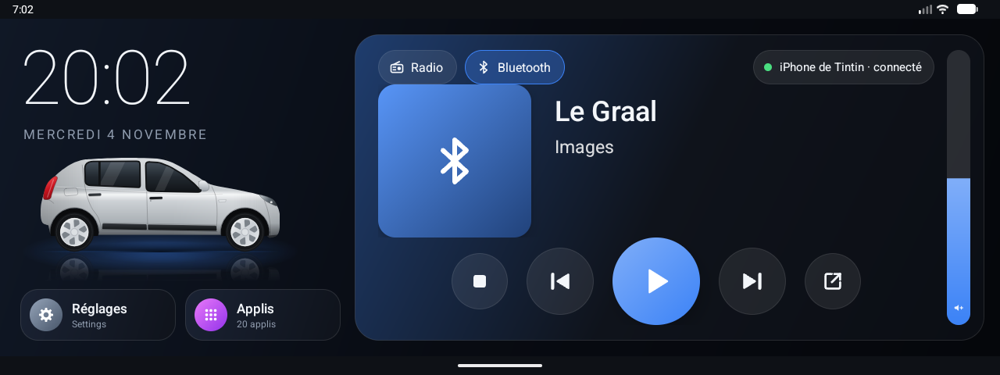
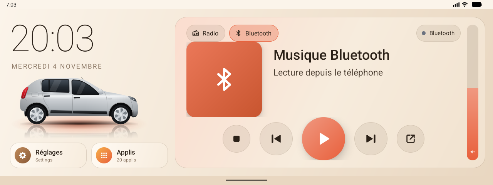

# Sandero Launcher

Une interface moderne pour les autoradios Android **Topway TW11 1280×480** (Allwinner T3, Android 8.1), conçue pour une Dacia Sandero 1, dans l'esprit des écrans VW / Audi / Mercedes.

## Ce que ça fait
- **Remplace l'écran d'accueil d'origine** : démarre seul et revient au premier plan au réveil.
- **Carte audio** : Radio et Bluetooth (tout le son du téléphone), titre, artiste, commandes, nom et état du téléphone connecté, curseur de volume vertical.
- **Caméra de recul intégrée** : la musique continue pendant la marche arrière, avec retour à l'accueil au point mort.
- **Dessin de la Sandero 1**, avec phares animés quand les feux s'allument.
- **Thème jour / nuit** automatique (nuit de 18 h à 9 h) ou forcé.
- **Heure toujours juste** : heure de Paris même si l'autoradio est réglé sur Shanghai, recalage GPS possible.
- **Outils** : sauvegarde de l'autoradio sur clé USB, allègement du système, moniteur des messages de l'autoradio, journal des 1000 dernières actions (pour signaler un bug).

Tout passe par l'API interne Topway (`TWUtil`) et les annonces des applis Topway : **pas de root nécessaire**.

## Compatibilité
Testé sur un autoradio Topway `ro.tw.version = V8.1.1_20220907.180036_TW11-1280x480-X` (Android 8.1, Allwinner T3). D'autres modèles Topway TW/T3 devraient fonctionner, au moins en partie. Sur un appareil sans `TWUtil`, les fonctions autoradio affichent « indisponible » sans planter.

## Installer
1. Télécharger `Sandero_VXXX.apk` (XXX = numéro de version, ex. `Sandero_V013.apk`) dans les **Releases** du dépôt (ou le compiler, voir plus bas).
2. Le copier sur une clé USB, l'ouvrir sur l'autoradio avec le gestionnaire de fichiers (autoriser les sources inconnues si demandé).
3. Appuyer sur Accueil → **Sandero** → **Toujours**.
4. Accepter les autorisations (caméra, localisation pour l'heure GPS). Dans Outils, accorder « Accès à l'utilisation » pour que Sandero chasse le lanceur d'origine.
5. Dans les réglages Topway, **décocher « Reversing mute »** (Paramètres → Son) pour garder la musique en marche arrière.

Mode d'emploi : [docs/GUIDE_UTILISATION.md](docs/GUIDE_UTILISATION.md).

## Compiler
Projet Android Studio dans `SanderoLauncher/` (Java, sans dépendance). Ouvrir le dossier dans Android Studio, puis *Build → Build APK(s)*. Avec un JDK 21 en ligne de commande : `gradle assembleDebug` (voir `SanderoLauncher/README.md`).

## Signaler un problème
Outils → **Exporter le journal sur la clé**, puis joindre `journal.txt` à l'issue. Le journal contient l'heure, les actions, les messages de l'autoradio et les erreurs, sans donnée personnelle hormis le nom du téléphone appairé (à effacer si besoin).

## Organisation du dépôt
| Dossier | Contenu |
|---|---|
| `SanderoLauncher/` | Code source de l'appli |
| `docs/` | Guide d'utilisation, captures |
| `tools/` | Scripts ADB (récupération du système, sauvegarde du boot d'origine, allègement), analyse des applis Topway, rendu 3D de la voiture ; `tools/externes/` : Magisk et Zadig |
| `autoradio/` | Firmware de l'autoradio de référence (fichiers système, applis Topway et AOSP, infos nettoyées des identifiants), firmware OTA T3-P1, futures images de partitions — voir `autoradio/README.md` |
| `release/` | Toutes les versions compilées de Sandero (`Sandero_VXXX.apk`) |
| `3D/` | Modèle 3D de la Sandero |
| `.claude/` | `CLAUDE.md` à la racine + **skills** : toute la connaissance de l'autoradio (API TWUtil, messages, Bluetooth, caméra, radio, système), utilisable par [Claude Code](https://claude.com/claude-code) |

Les gros fichiers (firmware) sont stockés par **Git LFS** : installer `git lfs` avant de cloner.

## Avertissement
Projet personnel, sans lien avec Topway. Il modifie le comportement de l'autoradio (écran d'accueil, caméra, sources audio) : à utiliser à vos risques. Gardez une sauvegarde (Outils → Sauvegarde complète) et le firmware d'origine de votre autoradio. Ne publiez jamais d'APK Google ou d'autres applis tierces, ni vos journaux et exports bruts : ils sont protégés par le droit d'auteur ou contiennent des données personnelles (numéro de série, licence OTA, adresses MAC, titres écoutés).
