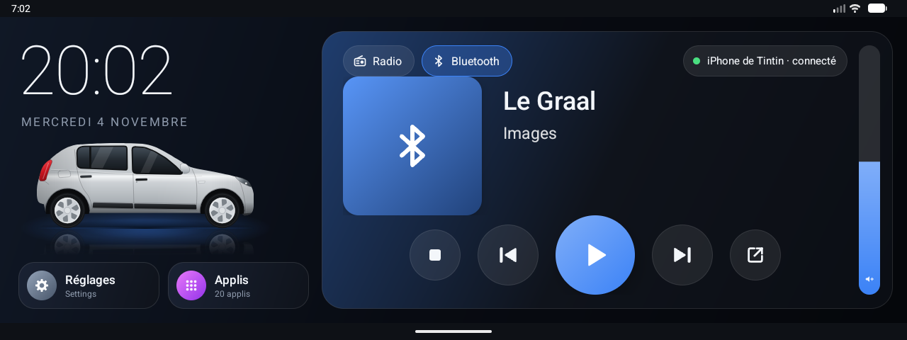
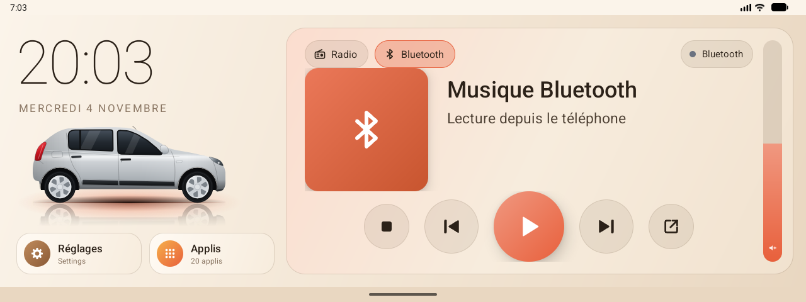

# Guide rapide de Sandero

## L'écran d'accueil

**À gauche**
- **Heure et date** : heure de Paris, même si l'autoradio est réglé sur un autre fuseau.
- **La Sandero** : ses phares s'allument quand vous allumez les feux. **Appui long sur la voiture → Outils.**
- **Réglages** : ouvre les paramètres Android. Appui long : choisir une autre appli.
- **Applis** : toutes les applis installées. Le bouton « Outils » est en bas de la liste.

**À droite, la carte audio**
- **Radio / Bluetooth** en haut à gauche : la source affichée. Choisir Bluetooth envoie le son du téléphone dans les haut-parleurs. La carte suit aussi l'autoradio : si la source change au volant, elle bascule toute seule.
- **Pastille en haut à droite** : le téléphone connecté et son état (point vert = connecté, orange = connexion en cours, gris = déconnecté). Appui : appli Bluetooth Topway, pour appairer un téléphone.
- **Bluetooth** : titre et artiste du téléphone. Boutons : stop, précédent, lecture/pause, suivant, appli Bluetooth.
- **Radio** : fréquence, nom de la station, texte RDS, 6 présélections (toucher pour écouter). Boutons : recherche automatique, recherche ◀◀ / ▶▶ (appui long : pas à pas), marche/arrêt, FM/AM.
- **Curseur de volume** (bande verticale à droite) : glisser vers le haut ou le bas. Un simple appui en haut ou en bas change d'un cran. Il suit aussi la molette.

## Marche arrière

La fenêtre Sandero s'ouvre : l'image de la caméra à droite, la musique et ses commandes à gauche. Au point mort, retour à l'accueil.
- **Retour** : revenir à l'accueil.
- **Caméra suivante** : si l'image est noire, essaie le numéro suivant et le retient.
- **Écran Topway** : revenir à l'écran de recul d'origine.

Pour **garder le son** en marche arrière, décochez « Reversing mute » dans les réglages Topway (Paramètres → Son).

## Jour et nuit

Mode **nuit** (interface sombre) de 18 h à 9 h, mode **jour** (tons chauds) le reste du temps. Pour forcer un mode : Outils → **Affichage → Thème**. Le choix est gardé jusqu'au prochain changement.

## Les Outils (appui long sur la voiture)

| Section | Usage |
|---|---|
| Choisir la clé USB, exports | Copier les applis, le système ou tout (« Sauvegarde complète ») sur une clé |
| Image des partitions (root) | Copie brute de l'autoradio, seulement si le root est disponible |
| Système et allègement | Libérer la mémoire, désactiver les applis inutiles, accélérer les animations |
| Affichage | Thème automatique / jour / nuit |
| Journal et heure | Voir / exporter le journal, fuseau d'affichage, recalage GPS de l'heure |
| Autoradio | Moniteur TWUtil (messages en direct), intégration Topway, démarrage, retour au premier plan, accès à l'utilisation |
| Véhicule → OBD2 | Valeurs du moteur en direct, codes défaut, VIN, enregistrement CSV, avec un module OBD2 « ELM327 » (Bluetooth, Wi-Fi ou USB) |
| Caméra de recul | Activer la caméra dans Sandero, choisir le numéro de caméra, tester |
| Garde-fous | Après un plantage, l'intégration Topway se coupe toute seule ; bouton « Réactiver » et journal des plantages |

## OBD2 (Outils → Véhicule → OBD2)

1. Brancher le module OBD2 (prise sous le volant), mettre le contact.
2. **Liaison** : Bluetooth (appairer d'abord le module, code 1234 ou 0000), Wi-Fi (connecter l'autoradio au réseau du module, souvent « WiFi_OBDII ») ou USB.
3. **Module** : choisir l'appareil, puis **Se connecter**. Seules les valeurs que la voiture annonce s'affichent.
4. Onglets : **Valeurs** en direct, **Défauts** (voyant moteur, codes), **Infos** (protocole, VIN), **Terminal** (commandes ELM à la main).
Lecture seule : rien n'est effacé. « Enregistrer en CSV » crée un fichier par session dans `Android/data/fr.sandero.launcher/files/obd/`.

## En cas de problème

1. Outils → **Exporter le journal sur la clé** → `journal.txt`.
2. Joindre ce fichier au signalement (issue GitHub), avec ce que vous faisiez et l'heure.
3. Bluetooth bloqué après un plantage : forcer l'arrêt de Sandero et de l'appli Bluetooth, redémarrer complètement l'autoradio, oublier l'autoradio sur le téléphone puis réappairer.
4. Revenir à l'interface d'origine : Paramètres → Applis → Applis par défaut → Appli d'accueil, ou désinstaller Sandero.
